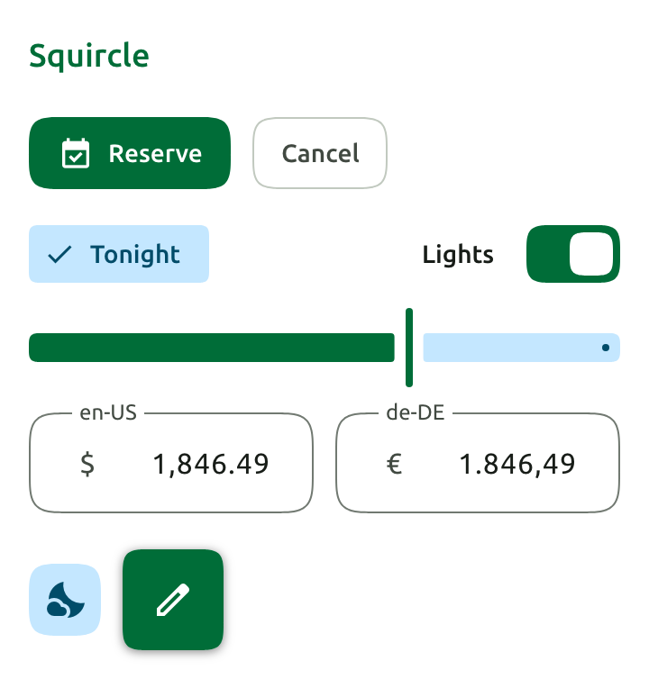
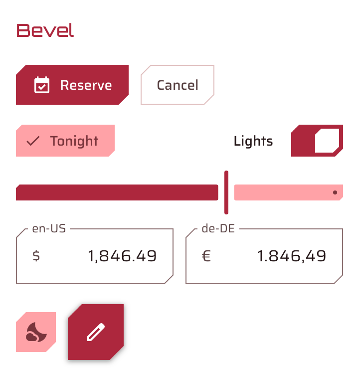

<p align="center"></p>

# Chameleon UI MCP server

Ask your agent about the Chameleon UI component library for Web/JS, React, Blazor, Angular, Vue, and Svelte. The server answers from the public documentation and checks its code before answering.

This server is **hosted, free to use, and read-only. It needs no key, no account, and no install.**

```text
https://chameleonui.io/mcp
```

## Connect your agent

### Claude Code

```bash
claude mcp add --transport http chameleon https://chameleonui.io/mcp
```

### VS Code

Add to `.vscode/mcp.json`:

```json
{
  "servers": {
    "chameleon": { "type": "http", "url": "https://chameleonui.io/mcp" }
  }
}
```

### Cursor

Add to `~/.cursor/mcp.json`:

```json
{
  "mcpServers": {
    "chameleon": { "url": "https://chameleonui.io/mcp" }
  }
}
```

### Gemini CLI

```bash
gemini extensions install https://github.com/materia-technologies-inc/chameleon-mcp
```

### Any other client

Add a remote MCP server with the URL above. The transport is Streamable HTTP.

The [AI agents guide](https://chameleonui.io/get-started/ai-agents) covers more clients and setup steps.

## About Chameleon UI

Chameleon UI is a library of Material 3 Expressive web components. One seed color generates a full theme, and corner shapes, squircles included, work in every browser. Here are the same components in two themes and two corner shapes.

<p align="center">
<a href="https://chameleonui.io"></a>
<a href="https://chameleonui.io"></a>
</p>

## What to ask

**"Check this before you use it: `<cw-button varient="filled" @clicked="save">Save</cw-button>`"**

`check_code` reads the snippet against the API. It never runs it. It returns each name the API does not have, with the fix (abridged):

```text
error  line 1  `varient` is not an attribute of cw-button.
               Fix: use `variant` instead.
error  line 1  `@clicked` is not an attribute of cw-button.
               Fix: its attributes are listed by docs_get, section "properties".
```

**"Is #9e9e9e text readable on white?"**

`check_contrast` gives the WCAG 2 contrast ratio and the verdicts (abridged):

```text
ratio 2.67   AA normal text: fail   AA large text: fail   AA user interface: fail
```

**"Make me a theme from #0b6e4f."**

`generate_theme` returns every color token's light and dark value, and the stylesheet that applies them.

## Tools

**Documentation**

| Tool | What it does |
| :--- | :--- |
| `list_components` | Lists every component, by framework |
| `docs_get` | Gets a component's API for Web/JS, React, Blazor, Angular, Vue, and Svelte |
| `get_example` | Returns working example code |
| `docs_search` | Searches the documentation |

**Code checks**

| Tool | What it does |
| :--- | :--- |
| `check_code` | Returns every name in a snippet that is not in the API, with the fix |

**Color**

| Tool | What it does |
| :--- | :--- |
| `generate_theme` | Builds a theme's tokens and stylesheet from one seed color |
| `check_contrast` | Checks a pair of colors or tokens against WCAG 2 |
| `nearest_tokens` | Maps raw colors to the nearest Chameleon UI tokens |

**Product facts**

| Tool | What it does |
| :--- | :--- |
| `get_product_facts` | Returns dated figures measured from the published packages, each with the page that shows it |

Every tool takes an optional `version`: the Chameleon UI release to answer from, such as `27.1`, or `27` for the latest 27 minor. Leave it out for the default release.

## What you can rely on

- **Read-only.** No tool changes anything, anywhere.
- **No account.** Nothing to sign in to and no key to manage.
- **Rate limit.** 60 calls a minute.
- **What is recorded.** Hourly totals of which tools were called, by which client program, and whether the calls succeeded. Never your question, your code, your colors, or the answer. The [privacy notice](https://chameleonui.io/legal) lists exactly what is kept.
- **Cost.** The server is free to use. The Chameleon UI components are licensed; see [chameleonui.io](https://chameleonui.io).

## About this repository

The server is hosted at chameleonui.io, and its source is not public. This repository holds only the files that MCP catalogs and clients read: the registry entry, the extension and plugin manifests, and this README.

- Documentation: [chameleonui.io](https://chameleonui.io)
- Getting started with agents: [chameleonui.io/get-started/ai-agents](https://chameleonui.io/get-started/ai-agents)
- Documentation for language models: [chameleonui.io/llms.txt](https://chameleonui.io/llms.txt)
- Report a problem: [chameleon-issue-tracker](https://github.com/materia-technologies-inc/chameleon-issue-tracker/issues)
